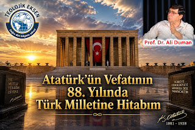

# Akademi Türkiye

Hakemsiz, sansürsüz, özgür bilim platformu.

## Hakkımızda

Akademi Türkiye; bilimsel yazıların, araştırmaların ve
düşüncelerin okurlarla buluşması amacıyla oluşturulmuştur.

## Makaleler

<a href="Atatürk.pdf" target="_blank" rel="noopener">Atatürk'ün Vefatının 88. Yılında Vaziyetimiz</a>

<a href="HzOmer.pdf" target="_blank" rel="noopener">AtaHz. Ömer’in Müslüman Olması ile İlgili Rivayetler Hakkında Bir Değerlendirme</a>

<a href="hzmuh-dogumu.pdf" target="_blank" rel="noopener">Hz. Muhammed’in Doğumunda Kâinatın Düzeni Değişti mi? Rivayetler, Kur’an ve Peygamber Tasavvuru</a>

<a href="baglam.pdf" target="_blank" rel="noopener">Kur’an’ı Anlamanın Anahtarı: Bağlam</a>

<a href="ilahiyatfakulteleri.pdf" target="_blank" rel="noopener">İlahiyat fakültelerinin bugünkü durumu</a>

<a href="sefaatanlayisi.pdf" target="_blank" rel="noopener">Şefaat Anlayışı ile Torpil Kültürü Arasındaki İlişki</a>

<a href="IKINCI-DOSYA.pdf" target="_blank" rel="noopener">İkinci makalenin başlığı</a>
