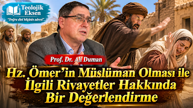

<header id="ust" style="background:#102b46; color:#ffffff; padding:30px 20px; border-radius:12px; margin-bottom:28px;">

  

    

    

      <h1 style="color:#ffffff; font-size:36px; margin:0 0 12px; border:0;">Akademi Türkiye</h1>
      
Hakemsiz, sansürsüz, özgür bilim platformu.

      
Bilimsel yazılar, araştırmalar ve düşünceler

    

  

  <nav aria-label="Ana menü" style="display:flex; justify-content:center; flex-wrap:wrap; gap:24px; margin-top:26px; padding-top:18px; border-top:1px solid #60768b;">
    <a href="#ust" style="color:#ffffff; text-decoration:underline;">Ana Sayfa</a>
    <a href="#hakkimizda" style="color:#ffffff; text-decoration:underline;">Hakkımızda</a>
    <a href="#makaleler" style="color:#ffffff; text-decoration:underline;">Makaleler</a>
  </nav>

</header>

<h2 id="hakkimizda">Hakkımızda</h2>

Akademi Türkiye; bilimsel yazıların, araştırmaların ve
düşüncelerin okurlarla buluşması amacıyla oluşturulmuştur.

<h2 id="makaleler">Makaleler</h2>

<a href="Atatürk.pdf" target="_blank" rel="noopener">Atatürk'ün Vefatının 88. Yılında Vaziyetimiz</a>

<a href="HzOmer.pdf" target="_blank" rel="noopener">Hz. Ömer’in Müslüman Olması ile İlgili Rivayetler Hakkında Bir Değerlendirme</a>

<a href="hzmuh-dogumu.pdf" target="_blank" rel="noopener">Hz. Muhammed’in Doğumunda Kâinatın Düzeni Değişti mi? Rivayetler, Kur’an ve Peygamber Tasavvuru</a>

<a href="baglam.pdf" target="_blank" rel="noopener">Kur’an’ı Anlamanın Anahtarı: Bağlam</a>

<a href="ilahiyatfakulteleri.pdf" target="_blank" rel="noopener">İlahiyat fakültelerinin bugünkü durumu</a>

<a href="sefaatanlayisi.pdf" target="_blank" rel="noopener">Şefaat Anlayışı ile Torpil Kültürü Arasındaki İlişki</a>

<a href="IKINCI-DOSYA.pdf" target="_blank" rel="noopener">İkinci makalenin başlığı</a>
